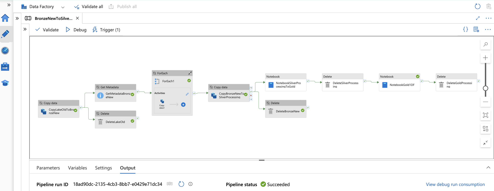

# 🐝 Bee Haven — Azure Data Engineering Pipeline

A data pipeline on Azure that takes hive sensor readings from two bee hives in Germany (Schwartau and Würzburg), pairs them with historical weather data, and turns the whole thing into clean tables that are ready for analysis.

I built this as a project during the Data Engineering course at WBS Coding School. It is a learning project, not a production system.

## What it does

The hive data arrives as CSV files, one per measurement and location: flow, humidity, temperature and weight. On its own that only shows what happened inside the hive. To understand why, I also needed the weather, so the pipeline pulls matching historical weather from the [BrightSky API](https://brightsky.dev/) (temperature, precipitation, pressure, sunshine, wind, cloud cover, dew point, relative humidity and solar radiation) and joins it to the sensor readings by location and timestamp.

Everything moves through the usual three medallion layers:

- **Bronze** holds the raw files exactly as they came in
- **Silver** holds the cleaned and standardised data
- **Gold** holds the merged, analysis-ready data

## How the pipeline runs



**Bronze.** New hive files land in `bronze/new`. An Azure Data Factory pipeline picks them up with Get Metadata and a ForEach loop, uses dynamic content to route each file, and moves the originals to `bronze/archive` once they are handed over.

**Silver.** A Synapse notebook reads the files waiting in `silver/processing` and does the cleaning:

- tidies up column names and sensor values
- converts timestamps from local time to UTC
- drops duplicate rows
- fetches the weather for the same period and location from BrightSky
- writes the results as Parquet into the Silver folders, plus a copy into `gold/processing` for the next step

**Gold.** A second notebook reads the Parquet files from `gold/processing`, groups them by location and merges sensor and weather measurements on the timestamp. Both the hive and the weather have a temperature and a humidity column, so I kept the hive ones separate to avoid mixing them up. Schwartau and Würzburg are then combined into one dataset.

Two files come out at the end:

1. a unified dataset with hive and weather data at timestamp level
2. a daily aggregate per location

## Repository layout

Only part of the project lives here: sample source data, the two notebooks and the docs. The full pipeline and the data layers are in Azure.

```
Bee Haven/
├── 1. data/
│   ├── schwartau/
│   │    ├── flow_schwartau.csv
│   │    ├── humidity_schwartau.csv
│   │    ├── temperature_schwartau.csv
│   │    └── weight_schwartau.csv
│   └── wurzburg/
│        ├── flow_wurzburg.csv
│        ├── humidity_wurzburg.csv
│        ├── temperature_wurzburg.csv
│        └── weight_wurzburg.csv
│
├── 2. notebooks/
│   ├── 2.1. silver_processing_to_silver_and_to_gold_processing.ipynb
│   └── 2.2. gold_processing_to_gold.ipynb
│
├── 3. docs/
│   ├── pipeline.png
│   └── WIP_III.png
│
└── README.md
```

And this is how I organised the data lake:

```
Azure Data Lake Storage Gen2
├── bronze/
│   ├── new/
│   └── archive/
│
├── silver/
│   ├── processing/
│   ├── flow/
│   ├── humidity/
│   ├── temperature/
│   ├── weight/
│   └── weather/
│
└── gold/
    ├── processing/
    └── ... final files
```

## Tools

| Tool | Used for |
|---|---|
| Azure Data Lake Storage Gen2 | storing all three layers |
| Azure Data Factory | ingestion, archiving, orchestration and scheduling |
| Azure Synapse Analytics | running the notebooks on a Spark pool |
| Python and pandas | cleaning, transforming and merging |
| fsspec | reading from and writing to the data lake |
| Parquet | file format for everything after Bronze |
| BrightSky API | historical weather data |
| Azure RBAC / IAM | access management |

## My Azure setup

I set up the following in Azure for this project:

- a resource group
- a Data Lake Storage Gen2 account with `bronze`, `silver` and `gold` containers laid out as shown above
- a Data Factory instance
- a Synapse workspace with a Spark pool
- RBAC roles so that Data Factory and Synapse can read and write the storage account

I wrote the notebooks for Synapse Spark, so they will not run locally as they are. I did not put storage credentials or other environment-specific values in this repo. In the notebooks I replaced them with placeholders.

I also set up the Data Factory pipeline so it can run on a schedule and process new files automatically.

## Testing

I ran the pipeline first with the historical hive data and then with an extra data drop, to check that new files really go through the automated flow from start to finish.

When something broke, I used the Data Factory monitoring view to see which activity failed and on which file, and the Synapse run logs to see what happened inside the notebooks.

## Background

This was a course project at WBS Coding School. It gave me hands-on practice with Data Factory, Synapse, Spark, the medallion architecture, pipeline automation and bringing in data from an external API. A good part of it also overlaps with the topics of the Microsoft Azure Data Fundamentals (DP-900) exam.
